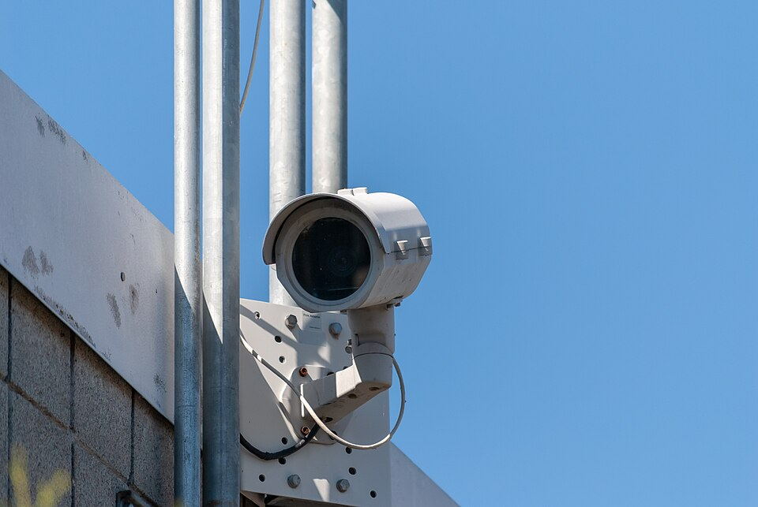
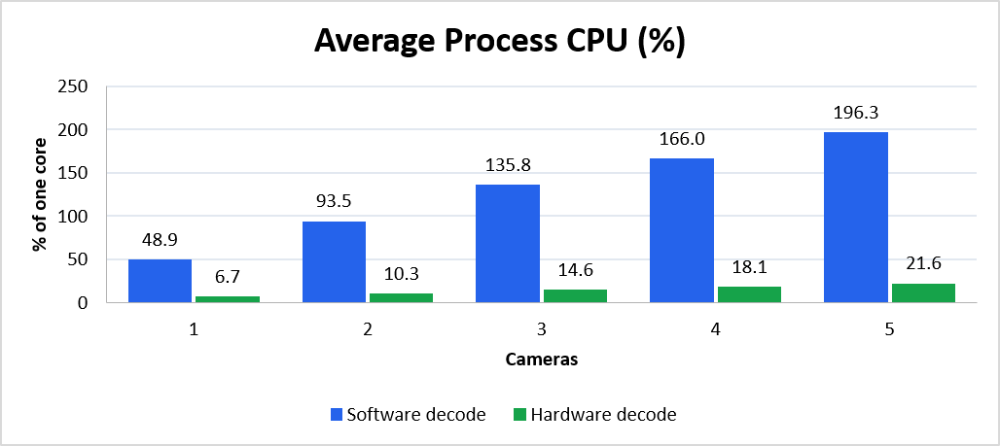
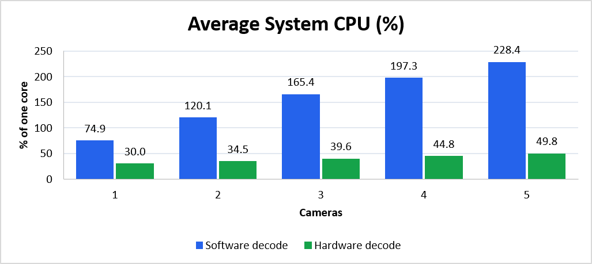
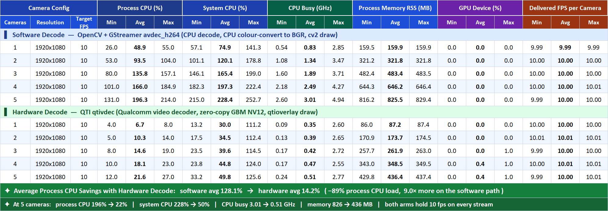
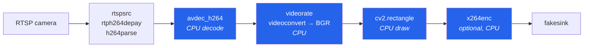
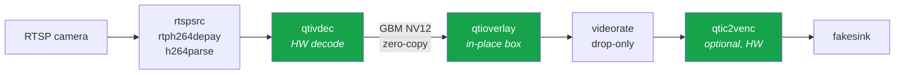

# Hardware vs Software Video Decode on Qualcomm QCS6490

**Multi-camera RTSP benchmark: Qualcomm hardware codec (`qtivdec`) vs CPU decoding (OpenCV + `avdec_h264`).**


<p align="center">
  <br>
  <sub>Typical RTSP source: an IP security camera. Photo: Cody Logan, <a href="https://commons.wikimedia.org/wiki/File:Security_camera,_September_2018.jpg">Wikimedia Commons</a>, CC BY-SA 4.0</sub>
</p>

Edge video-analytics boxes typically decode several IP-camera streams at once and draw
detections on every frame. This project measures what that costs on a **Qualcomm QCS6490**
board when decoding happens in **hardware**, compared with the usual **software** path.

Both pipelines do exactly the same job per camera:
**RTSP in → H.264 decode → limit to the target fps → draw a bounding box → (optional) re-encode**.
They differ only in *where* the codec and pixel work runs.

---

## Key results

> **Hardware decode cuts process CPU by ~89% (9× less), system CPU by up to 78%, and memory
> by ~46%, while both arms hold the full 10 fps on every stream.**

Test setup: 1–5 cameras, 1920×1080 H.264 at 10 fps target. Camera processes pinned to
the big cores (4–7). Each point is a 60 s measurement after a 10 s warm-up.

### Average resource usage per camera count

| Cameras | Process CPU (%)<br>SW → HW | Reduction | System CPU (%)<br>SW → HW | Reduction | CPU busy (GHz)<br>SW → HW | Memory RSS (MB)<br>SW → HW | Delivered FPS / cam<br>SW / HW |
|:---:|:---:|:---:|:---:|:---:|:---:|:---:|:---:|
| 1 | 48.9 → **6.7**   | −86% (7.3×) | 74.9 → **30.0**  | −60% | 0.83 → **0.35** | 159.9 → **87.2**  | 9.99 / 10.00 |
| 2 | 93.5 → **10.3**  | −89% (9.1×) | 120.1 → **34.5** | −71% | 1.34 → **0.39** | 321.8 → **173.7** | 10.00 / 10.01 |
| 3 | 135.8 → **14.6** | −89% (9.3×) | 165.4 → **39.6** | −76% | 1.89 → **0.42** | 483.4 → **261.9** | 10.00 / 10.00 |
| 4 | 166.0 → **18.1** | −89% (9.2×) | 197.3 → **44.8** | −77% | 2.49 → **0.47** | 646.2 → **348.5** | 10.00 / 10.01 |
| 5 | 196.3 → **21.6** | −89% (9.1×) | 228.4 → **49.8** | −78% | 3.01 → **0.51** | 825.5 → **436.4** | 10.00 / 10.00 |

*CPU % is a share of one core (100% = one core fully busy; the board has 8 cores = 800%).*

### Cost of each additional camera

Least-squares slope over 1–5 cameras:

| Metric | Software decode | Hardware decode | Difference |
|---|---:|---:|---:|
| Process CPU | +36.7 % / camera | **+3.8 % / camera** | ~9.8× less |
| System CPU  | +38.4 % / camera | **+5.0 % / camera** | ~7.7× less |
| CPU busy    | +0.55 GHz / camera | **+0.04 GHz / camera** | ~14× less |
| Memory RSS  | +166 MB / camera | **+87 MB / camera** | ~1.9× less |

### At 5 cameras

| | Software | Hardware |
|---|---:|---:|
| Process CPU | 196% (~2 cores) | **22%** |
| System CPU | 228% | **50%** |
| CPU busy | 3.01 GHz | **0.51 GHz** |
| Memory RSS | 826 MB | **436 MB** |
| GPU load | 0% | 0.4% (overlay blit) |
| Delivered FPS | 10 fps on every stream | 10 fps on every stream |

### Charts

<p align="center">
  
  
</p>

<details>
<summary><b>Full report (min / avg / max for every metric)</b></summary>



</details>

---

## How it works

### Software arm: `rtsp_videoloop_opencv.py`



### Hardware arm: `qti_videoloop.py`



| Step | Hardware arm | Software arm |
|---|---|---|
| Transport | `rtspsrc`, `rtph264depay`, `h264parse` | same elements |
| Decode | `qtivdec turbo=true` | `avdec_h264` (FFmpeg) |
| Rate | `videorate drop-only=true` | `videorate` |
| Scale | `qtivtransform` (only with `RES=WxH`) | `videoscale` (passes through at native) |
| Bounding box | `qtioverlay overlay-bbox`, drawn in place | `cv2.rectangle` on a BGR frame |
| Encode (optional) | `qtic2venc` | `x264enc` |
| Memory | GBM device memory end to end: the CPU never touches a pixel | system memory, with a colour conversion to BGR |

Both arms import [`loop_common.py`](rtsp_video_loop/loop_common.py), so they share the same
CLI defaults, box geometry, output rate and `SUMMARY` line format. The comparison stays
like-for-like.

---

## Repository layout

```
.
├── rtsp_video_loop/            # the two pipelines and the benchmark drivers
│   ├── qti_videoloop.py        # hardware arm (qtivdec + qtioverlay [+ qtic2venc])
│   ├── rtsp_videoloop_opencv.py# software arm (avdec_h264 + OpenCV [+ x264enc])
│   ├── loop_common.py          # shared arguments, box, and FPS accounting
│   ├── run_videoloop.sh        # one run: N cameras on one arm, with metrics
│   ├── run_matrix.sh           # full sweep: idle baseline, 1..N cams on both arms, report
│   ├── diag_qti.py             # stage-by-stage diagnostics of the QTI pipeline
│   ├── cams.example.txt        # template for cams.txt (your RTSP URLs, git-ignored)
│   └── README.md               # detailed design notes
├── metrics_monitor/            # stdlib-only measurement tools
│   ├── metrics_logger.py       # samples CPU / clocks / GPU / RSS to JSON lines
│   ├── compare_metrics.py      # builds the HW vs SW report from a run directory
│   ├── monitor_metrics.sh      # live view of a running log
│   └── README.md
└── docs/images/                # README images and charts
```

---

## Getting started

### Prerequisites

On the target board (tested on a Qualcomm **QCS6490** with GStreamer 1.16):

- Python 3.8+ with `python3-gi` (GStreamer bindings) and `numpy`
- GStreamer base/good/bad plugins and **gst-libav** (`avdec_h264`) for the software arm
- **OpenCV built with GStreamer support**. The pip `opencv-python` wheel does *not* include it.
  Check with `python3 -c "import cv2; print(cv2.getBuildInformation())" | grep GStreamer`.
- Qualcomm IM SDK GStreamer plugins (`qtivdec`, `qtioverlay`, `qtivtransform`, `qtic2venc`)
  for the hardware arm
- `taskset` (util-linux) for core pinning

### 1. Configure your cameras

```bash
cd rtsp_video_loop
cp cams.example.txt cams.txt
# edit cams.txt: one RTSP URL per line, e.g. rtsp://<user>:<password>@<camera-ip>:554/<path>
```

`cams.txt` is listed in `.gitignore`, so your camera addresses and credentials never get committed.

### 2. One-time board setting (hardware arm)

`qtioverlay` only draws the box correctly with the C2D blit engine set to `0`:

```bash
setprop persist.overlay.use_c2d_blit 0
```

### 3. Run the benchmark

```bash
./run_matrix.sh 5                  # idle baseline, then 1..5 cameras on each arm, then the report
ENCODE=h264 ./run_matrix.sh 5      # the same, plus H.264 re-encoding
FPS=5 ./run_matrix.sh 5            # both arms at 5 fps

./run_videoloop.sh qti 3           # a single run: 3 cameras, hardware arm
./run_videoloop.sh opencv 3        # a single run: 3 cameras, software arm
```

Logs are written to `rtsp_video_loop/vlogs/<timestamp>/`. The report is printed and saved as
`report.txt`. To print it again:

```bash
python3 ../metrics_monitor/compare_metrics.py vlogs/<timestamp> --csv report.csv
```

To watch a running measurement from another terminal:

```bash
../metrics_monitor/monitor_metrics.sh            # follows the newest log
```

### Settings

All settings are environment variables and are applied identically to both arms:

| Variable | Default | Meaning |
|---|---|---|
| `FPS` | `10` | boxed frames per second each camera outputs |
| `RES` | `native` | output size: `native` (no scaling) or `WxH`, e.g. `1280x720` |
| `ENCODE` | `none` | `none` or `h264`: also re-encode the boxed video |
| `CODEC` | `h264` | what the camera sends: `h264` or `h265` |
| `DURATION` | `60` | seconds measured per run |
| `WARMUP` | `10` | seconds between launch and the start of measuring |
| `PIN` | `big` | cores used: `big` (4–7 on QCS6490), `all`, or a list such as `4-7` |
| `CAMS` | `cams.txt` | file with camera URLs |
| `OUT` | `vlogs/<timestamp>` | output directory |
| `QTI_DRAW` | `overlay` | hardware arm only: `overlay` or `composer` (older design; needs `RES=WxH`) |
| `BASELINE` / `COOLDOWN` | `20` / `15` | `run_matrix.sh` only: idle-baseline seconds / pause between runs |

---

## Measurement methodology

| Metric | Source | What it tells you |
|---|---|---|
| **Process CPU** | `/proc/<pid>/stat` utime+stime of the benchmark processes | CPU spent inside the pipelines themselves |
| **System CPU** | `/proc/stat`, all cores | everything, including kernel and driver work done for the hardware codec. This is the fair total |
| **CPU busy (GHz)** | busy fraction × average clock (cpufreq `time_in_state`), summed over cores | cycles actually spent, independent of DVFS governor decisions |
| **Memory RSS** | `/proc/<pid>/stat` | resident memory of the benchmark processes |
| **GPU** | `/sys/class/kgsl/kgsl-3d0/gpu_busy_percentage` | Adreno load (the overlay blit runs on the GPU) |
| **Delivered FPS** | per-camera `SUMMARY` line (frames after warm-up ÷ seconds) | proves both arms did the same amount of work |

Fairness measures built into the harness:

- **Core pinning** to the big cluster, so the scheduler doesn't move load between A55 and A78
  cores as camera count grows.
- **Alternating arm order** at each camera count, so neither arm always runs on a warmer board.
- **Idle baseline and cool-down** between runs.
- **Unsynchronized sinks** (`sync=false`), so the benchmark measures processing throughput.

See [`rtsp_video_loop/README.md`](rtsp_video_loop/README.md) and
[`metrics_monitor/README.md`](metrics_monitor/README.md) for full details.

---

## Image credits

- IP camera photo: [Security camera, September 2018](https://commons.wikimedia.org/wiki/File:Security_camera,_September_2018.jpg)
  by Cody Logan, licensed [CC BY-SA 4.0](https://creativecommons.org/licenses/by-sa/4.0/).
- Badges: [shields.io](https://shields.io).
- Charts and report tables: produced from this project's benchmark runs.
